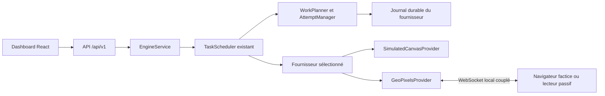

# GeoPlacer — Rapport de Phase 2A

Date des travaux : 16 novembre 2026. Branche locale : `feat/phase2a-geopixels-provider`.
Base vérifiée : `fe392266a0605349f227e005a5e62904903b531f`.

## Résultat fonctionnel et périmètre

Une fondation d'intégration exécutable est ajoutée : le dashboard couple un navigateur
factice, reçoit ses observations, lie explicitement un modèle local, fait planifier les
opérations par le scheduler existant, les exécute dans la page locale, journalise les
intentions et réconcilie les réponses perdues. La simulation historique reste disponible.

Le lecteur de cache GeoPixels est implémenté à partir du frontend public examiné, mais
son installation et son canal sur le vrai site restent **non validés**. Aucun placement,
achat, accès à un compte ou essai d'authentification sur GeoPixels n'a été effectué.
Le code livré ne contient aucun exécuteur d'écriture réelle.

## 1. Sources effectivement examinées

Les cinq dépôts ont été clonés dans un dossier temporaire distinct des projets conservés.
Les commits et dates ci-dessous sont ceux de ces clones, pas une supposition sur les versions.
Un inventaire avec empreintes de fichiers est conservé dans `test-logs/phase2a/sources.json`.
L'audit existant a été consulté pour les limites et la provenance ; aucune comparaison générale
n'a été recommencée et aucun fichier de l'audit n'a été modifié.

| Dépôt | Révision examinée | Date du commit | Sources utiles |
|---|---|---|---|
| [AntCDev/GeoPixelsFront](https://github.com/AntCDev/GeoPixelsFront/tree/74783afc5b7e3064a43eed20b0f6638007853324) | `74783afc5b7e3064a43eed20b0f6638007853324` | 2026-11-15, 22:55:48 −06:00 | `wwwroot/js/index.js`, `config.js`, `ghost.js`, `pixel-tile-layer.js`, `sync-worker.js`, `merge-worker.js`, `eventLayer.js`, `userProfile.js` |
| [Fox3225/GeoPixelsBotClean](https://github.com/Fox3225/GeoPixelsBotClean/tree/756472d3ac90f1b72c5fc8354aa6e89b53b7ac85) | `756472d3ac90f1b72c5fc8354aa6e89b53b7ac85` | 2026-09-25, 00:03:05 −03:00 | `ghostpixel-bot-clean.user.js`, version `1.1.9-clean`, README, licence |
| [Dax233/GeoPixelsBot](https://github.com/Dax233/GeoPixelsBot/tree/efda7d87cadbb27954f58041d8bccbdf9fce20a2) | `efda7d87cadbb27954f58041d8bccbdf9fce20a2` | 2026-03-29, 22:13:41 +08:00 | `ghostBot.user.js`, version `0.4.3`, géométrie du fantôme, cache, attente énergétique |
| [nymtuta/GeoPixelsBot](https://github.com/nymtuta/GeoPixelsBot/tree/218ccdd1c511e59fcfc56202444491deb9d80f76) | `218ccdd1c511e59fcfc56202444491deb9d80f76` | 2025-11-27, 11:07:48 +01:00 | `ghostBot.user.js`, README et changelog, calcul des cibles natives |
| [AzaelMew/geopixels-archive-world-map](https://github.com/AzaelMew/geopixels-archive-world-map/tree/bb745e131a85a29bea10986b7dfe54f602ec754c) | `bb745e131a85a29bea10986b7dfe54f602ec754c` | 2026-08-30, 17:44:34 +02:00 | README, stockage/serveur Go et `index.html`, archives et orientation des tuiles du visualiseur |

Le frontend désigné comme référence par l'utilisateur est sous MIT, copyright 2026 GeoPixels.
Les bots sont des références GPL ; aucun morceau de leur exécuteur, de leur authentification
ou de leur moniteur n'a été incorporé. Les nouveaux modules sont des implémentations originales
dans GeoPlacer, sous AGPL-3.0-only. Les attributions historiques de Wplacer sont conservées.
Une licence de code ne constitue pas une autorisation d'automatisation du service.

## 2. Contrats identifiés et divergences

| Contrat vérifié dans le code public | Conséquence dans l'adaptateur |
|---|---|
| `index.js`, constantes `SYNC_TILE_SIZE`, `TILE_GRID_SIZE` : 1000 ; clés `tileImageCache` sous forme `x,y` | Division par plancher, y compris aux coordonnées négatives ; tests sur −1001, −1000, −1, 999, 1000 |
| `ghost.js`, `ghostImageTopLeft`, limites du fantôme : X augmente, Y diminue de ligne en ligne | Une seule conversion image Y descendant → grille Y montant |
| `ghost.js/getMapPixelHex` et `merge-worker.js`, lignes locales `gridY - tileOriginY` | Lecture du bitmap déjà décodé selon le contrat du cache actuel |
| `index.js`, mise à `null` des bitmaps pendant la fusion | Les régions en cours de fusion sont inconnues ; aucun fond opaque inventé |
| `sync-worker.js`, `GetPixelsCached`, réponses `full`/`delta`, `ColorWebP`, `ServerTimestamp` | La version livrée lit le cache seulement ; elle n'appelle pas cette route et ne prétend pas reconstruire le monde complet |
| `index.js`, chargement `Colors` depuis `userData.colors`, couleur transparente ajoutée à part | Transmission des seules couleurs RGB valides disponibles, sans confondre transparence et couleur opaque |
| `eventLayer.js/getActiveEnergySource`, `computeEnergyState` : ressources différentes entre base et événements | Refus explicite des événements dans le lecteur de cette phase |
| `index.js`, énergie stockée, `checkedTick`, `energyRate` en secondes et surcapacité conservée | Champs absents à `null`, date conservatrice, aucune énergie initiale supposée depuis les variables par défaut du frontend |
| `index.js`, placement base via `PlacePixels` avec `{Token, Subject, UserId, Pixels}`, succès HTTP + texte `Ok` | Contrat étudié mais **non implémenté comme écrivain réel**, secrets jamais envoyés au serveur GeoPlacer |
| `userProfile.js/MakePurchase`, catégories et paramètres spécifiques | Aucun prix ou niveau du service considéré assez vérifié pour autoriser une dépense ; politiques testées avec les règles synthétiques |

Le décodeur direct de tuiles complètes de Fox3225 (`readFullTilePixels`) inverse les lignes à
partir du sommet de la tuile ; il ne faut pas l'appliquer une seconde fois au cache du frontend.
`buildTargets`, `getRemainingTargets` et `syncBoard` de ce bot ont été examinés pour les zones,
les priorités de couleur, les régions et la synchronisation. Ses fonctions énergétiques et
d'achat peuvent retomber sur des valeurs locales ou des appels authentifiés. Son moniteur
`127.0.0.1:47631/connect` transmet une charge d'authentification : ce dispositif n'est pas repris.

L'archive AzaelMew traite des dumps datés, des versions immuables et des tuiles de visualisation
(notamment 256 pixels dans son viewer), avec ses propres inversions d'image. Ce stockage n'est
ni une source temps réel, ni le cache natif de 1000 pixels ; il n'est pas branché au scheduler.

GeoPlacer supposait jusque-là une seule toile simulée, des ressources toujours disponibles
et un journal unique. Ces hypothèses deviennent respectivement : source explicite, ressources
incomplètes/anciennes possibles et journaux isolés. Les modèles locaux gardent leur namespace
historique et leur quantification ; le lien avec le fantôme navigateur est explicite.

## 3. Architecture et nouveaux modules

Voir [ADR 0004](../decisions/0004-connecteur-geopixels-phase2a.md) pour les choix et garanties.

- `packages/engine-service/src/geopixels/protocol.ts` : contrat strict et validation bornée des observations.
- `provider.ts` : cache de couverture, dates, conversion native, lecteur, écrivain factice et résultats incertains.
- `pairing.ts` : capacité éphémère, origine exacte, usage unique et révocation.
- `EngineService.selectSource`, `bindConnector`, `connectorView`, `connectorProposals` : raccordement
  au même scheduler ; sélection persistée, liaison durable et présentation des propositions.
- `packages/adapters-node/src/attempt-journal.ts` : namespace du journal et de l'historique, sans
  altérer le protocole durable préexistant. Les sauvegardes incluent et diagnostiquent ce domaine.
- `packages/core/src/upgrades/policy.ts` : politiques appliquées à l'UpgradePlanner existant.
- `src/api/v1/connector-router.ts`, `connector-socket.ts` : surface de contrôle et transport spécialisé.
- `browser/geopixels-capture.js`, `geopixels-client.js` : lecteur passif et interface de couplage.
- `public/connector-fixture.*` : service factice dans un navigateur, stockage local et perturbations contrôlées.
- `frontend/src/components/geopixels/ConnectorDashboard.*` : source, connexion, modèle, observations,
  ressources incertaines, commandes, politique et propositions ; dashboard de simulation conservé.
- `scripts/build-connector.mjs` : génération déterministe des fichiers publics depuis `browser/`.
- `scripts/recette-connecteur.mjs`, `test-connector-channel.mjs`, `bench-geopixels-provider.mjs` : recettes et mesures locales.

## 4. Protocole navigateur / moteur

Le contrôle HTTP est limité au dashboard local de même origine, avec JSON strict.
La vérification du Host et de l'adresse distante impose une connexion loopback, même si
le reste du dashboard est volontairement exposé sur le LAN.

Le WebSocket spécialisé accepte uniquement l'origine exacte du couplage en attente.
Son premier message est `pair` avec version 1 et capacité aléatoire à usage unique.
Les messages suivants sont `observation`, `heartbeat` et `result`. Le serveur ne peut
émettre une commande `execute-fake` que vers un canal `local-fake`, jamais vers le vrai site.

Une observation porte session opaque, séquence, identité/génération du projet, origine native,
dimensions, rectangle natif, pixels RGB/transparents/inconnus, date de capture et date
d'observation séparées, ainsi que des ressources dont chaque champ peut être indisponible.
Les messages sont bornés à 1 Mo, les bandes à 65 536 pixels, le cache à quatre millions de
pixels. Les commandes sont limitées à 256 pixels et une seule commande en attente.

La commande référence l'identifiant durable de tentative et l'identité du projet. Le résultat
doit correspondre exactement à ses tâches et à son canal. Les délais, déconnexions et arrêts
n'effacent pas l'intention ; la réconciliation exige une preuve de couverture fraîche.
Une ancienne fermeture de socket ne peut pas invalider un nouveau canal couplé.

## 5. Opérationnel, factice et non livré

| Fonction | État dans cette branche |
|---|---|
| Simulation, huit stratégies, import, quantification, export PNG, API, WS, sauvegardes | Conservés ; tests existants exécutés |
| Couplage contrôlé, observations, liaison et progression dans le dashboard | Opérationnels sur page locale |
| Planification → intention disque → commande navigateur → résultat → progression | Opérationnel avec fournisseur factice |
| Réponse perdue, arrêt en vol, redémarrage, réconciliation | Testés localement, sans renvoi silencieux de l'opération incertaine |
| Lecteur des bitmaps du frontend actuel et conversions | Implémenté ; tests de contrat, DOM/canvas factices et navigateurs locaux |
| Fonctionnement du userscript sur le vrai site et compatibilité CSP/accès réseau local | Non testé ; recette interactive restante |
| Placement et achats réels | Non disponibles dans le code livré |
| Politiques, budget, réserve, capacité et bénéfices | Décision et propositions synthétiques testées ; aucune dépense exécutée |
| Surveillance permanente et file de plusieurs projets | Concepts du moteur conservés ; orchestration de ces parcours réels à compléter |
| Archives comme preuve temps réel | Exclues |

## 6. Vérifications et preuves

Les preuves détaillées, journaux complets et captures sont sous `test-logs/phase2a/`.
Les contrôles complets sont conservés sous `test-logs/*-check.log` ; les essais échoués
intermédiaires ne sont pas supprimés. Le dernier contrôle vert et le clone neuf seront
identifiés dans la section de validation finale ci-dessous.

Les tests ajoutés couvrent notamment : coordonnées négatives et bords de tuiles, orientation Y,
transparence et alpha partiel, couverture inconnue, données anciennes, messages désordonnés,
changement de session/modèle/position, snapshots immuables, ressources absentes, concurrence,
résultats retardés ou perdus, arrêt en cours d'opération, reprise disque et séparation des sources.
Les tests du moteur existant couvrent aussi les couleurs verrouillées et priorités.

Trois tests comparent tous les pixels éligibles d'observations en bandes à un modèle synthétique :
64 × 64, 595 × 894, 2000 × 2000. Ils sont distincts de l'image personnelle de la recette RC.
Le test de reprise ferme puis rouvre EngineService et rétablit le navigateur factice : aucun lot
déjà exécuté ne doit être renvoyé. Un test sauvegarde/restaure aussi le journal du connecteur.

Les huit scénarios HTTP/WebSocket utilisent de vrais sockets locaux : Host et origine,
capacité incorrecte, messages non autorisés, tentative d'achat/proxy, données supplémentaires,
usage unique, révocation et absence de secrets dans l'état public.

Les recettes Edge et Firefox emploient une toile factice 64 × 64, vérifient aussi le lecteur
de cache avec un vrai canvas navigateur aux frontières de tuiles, puis le parcours complet,
la modification externe, les propositions, la révocation et le retour à la simulation.
Elles bloquent les requêtes externes ; les captures sont celles d'une **page locale factice**.
Elles vérifient également le rechargement du navigateur sans perte des résultats et
l'enregistrement/relecture de modèles 595 × 894 et 2000 × 2000 via IndexedDB.
Le dessin navigateur de bout en bout porte sur 64 × 64 ; aucun dessin intégral de
quatre millions de pixels n'est annoncé comme testé dans un navigateur.

### Mesures locales indicatives

`node scripts/bench-geopixels-provider.mjs test-logs/phase2a/provider-performance.json`, Node 22.23.2, Windows.

| Taille | Ingestion | Copie d'instantané | Progression | RSS du processus |
|---|---:|---:|---:|---:|
| 64 × 64 | 3 ms | 1 ms | 4 ms | 42 Mio |
| 595 × 894 | 51 ms | 14 ms | 27 ms | 59 Mio |
| 2000 × 2000 | 179 ms | 72 ms | 129 ms | 138 Mio |

Ces chiffres sont une exécution synthétique, incluant le travail déjà fait dans ce processus ;
la RSS n'est pas une allocation nette. Ils excluent JSON réseau, TLS, décodage WebP, capture
réelle du site et rendu React. La copie synchrone d'une grande région peut bloquer brièvement
la boucle Node. Une production de grands flux demanderait un format binaire, des régions
différentielles et des mesures de réactivité plus poussées avant d'augmenter les limites.

## 7. Sécurité, limites et validation restante

- Les capacités de couplage restent en mémoire, hors URL, logs et sauvegardes. Elles sont
  comparées en temps constant puis consommées. Le navigateur doit être recouplé après redémarrage.
- Les cookies, jetons Google/GeoPixels et identifiants de compte ne traversent pas le canal.
  Le lecteur détecte un changement d'identité localement et ne transmet qu'une nouvelle session opaque.
- Les anciennes routes Wplace et leur client réseau restent désactivés. Aucun proxy générique.
- Le navigateur est une source déclarative, pas une preuve cryptographique du service.
  La limitation au faux écrivain est imposée côté moteur et origine, indépendamment des données reçues.
- La liaison compare identité du projet, position, modèle, révision et hash local sur reprise.
  L'identité du fantôme réel et le hash du modèle local ne sont pas automatiquement équivalents :
  la première liaison exige une vérification manuelle de l'image, palette et filtres.
- Les filtres natifs changent la génération du fantôme, mais ne remplacent pas les filtres locaux
  du TemplateManager. Les projets préparés pour export PNG ne sont pas automatiquement migrés
  dans la sélection historique des modèles de simulation.
- Les événements, ressources non vérifiées, caches anciens et sessions absentes n'autorisent
  aucune écriture. Les règles réelles de prix/niveaux et leurs résultats restent à formaliser.
- Le stockage de la page factice sert à tester les interruptions ; sa persistance n'est pas
  celle d'un service réel. Les preuves de non-duplication ne certifient aucun futur endpoint.
- Un futur écrivain devra prouver la fin d'une opération avant d'utiliser une lecture pour
  décider de la suite. Une lecture reçue pendant une requête réelle encore en vol ne suffit pas.

Étapes interactives restantes : autorisation du service et du périmètre d'intégration, installation
du lecteur par l'utilisateur, validation du canal local depuis HTTPS, comparaison de repères sur
une petite image asymétrique connue, observations de ressources et changements de session.
Une écriture réelle devra être conçue et examinée séparément, puis déclenchée volontairement
par l'utilisateur ; aucune activation distante cachée n'est fournie.

## 8. Plan de suite

1. Valider le lecteur passif et la fraîcheur/complétude sans placement ; documenter les écarts
   entre la révision publique examinée et le frontend effectivement servi.
2. Définir une interface d'intégration autorisée, les contrats de résultat et une procédure
   de fin d'opération/réconciliation avant tout écrivain réel.
3. Brancher cet écrivain sur les mêmes AttemptManager et scheduler, sans moteur navigateur supplémentaire.
4. Ajouter surveillance continue par observations différentielles et réévaluation des pixels
   corrects, puis file de projets au-dessus de la file de tâches existante.
5. Vérifier le catalogue et les règles de ressources réelles ; conserver la décision dans
   l'UpgradePlanner/politiques et une confirmation explicite pour les premières dépenses.
6. Étendre le choix des modèles aux projets préparés GeoPixels et mémoriser les préférences
   avancées de l'interface, sans requantification ou migration silencieuse des modèles existants.

## 9. Sauvegarde et état Git

Avant modification, l'arbre était propre au commit attendu. Un bundle complet `--all` a été
créé puis vérifié dans le dossier externe habituel :

`D:\Téléchargements\Code\GeoPlacer-sauvegardes\2026-11-16-avant-phase2a\GeoPlacer-avant-phase2a.bundle`

SHA-256 : `2488299ccc278095e20dfd887f7b312ac94c1c814c0c68ffbdc380360d59dc5c`.
Il contient 30 références et un historique complet. Les branches existantes n'ont pas été réécrites.

L'archive RC `release/geoplacer-6.0.0-rc.1-windows-fe39226.zip` est conservée, inchangée :
SHA-256 `0f8836d8d25038b4e5a2903a9cccf091f60e7b07dd95bc6c47e9a132af09b573`.

Commits locaux de réalisation :

- `143aae7` — contrats/fournisseur, couplage, politiques et tests unitaires.
- `5bc4af8` — raccordement du scheduler, journaux séparés, reprise, sauvegardes et canal.
- `8f0c49e` — lecteur navigateur, page factice, dashboard et recette locale.
- `feb39d6` — génération portable et cohérence des assertions de source expérimentale.
- `366e598` — persistance IndexedDB, rechargement, grandes images, recouplage et erreurs publiques.
- Un commit de documentation final contient ce rapport, le guide et l’ADR.

Aucun push, merge, tag, release, modification de GhostPixelBot-FR ou des sources d'audit.

## 10. Validation finale

Code de réalisation final : `366e5984daa89f710b9c00b7fc2924b7aacb4f7a`.
Les commits suivants de documentation ne changent pas ce code.

| Contrôle | Résultat |
|---|---|
| Jest | 171 tests réussis, 19 suites |
| Vitest core | 386 réussis, 1 optionnel ignoré |
| Vitest adapters-node | 66 réussis |
| Vitest engine-service | 135 réussis, dont 62 tests spécifiques du connecteur |
| Vitest simulator | 51 réussis |
| Total | **809 tests réussis**, 1 optionnel ignoré ; +74 par rapport aux 735 de la consolidation |
| TypeScript / lint | Aucune erreur ; 47 avertissements backend hérités, aucun avertissement frontend/packages |
| Build | Code de sortie 0 ; avertissement Vite préexistant sur `NODE_ENV=production` |
| Canal local | Huit scénarios HTTP/WebSocket réussis, dont contrôle de non-divulgation des erreurs internes |
| Edge / Firefox | Parcours local complet, rechargement et stockage des grandes images réussis ; aucune erreur de page ni requête externe |
| Clone neuf | Installation en une commande 0, `start.bat` en mode contrôle 0, `--check` 0, démarrage réel via recette Edge 0 et Git propre |
| Préservation | 18 anciennes branches inchangées, licence et archive RC inchangées |
| Recherche de secrets | Aucune détection à forte confiance dans les 41 fichiers de code introduits/modifiés ; les marqueurs de tests sont synthétiques |

Le contrôle global vert initial de cette phase est
`test-logs/2026-11-16T21-00-10-550Z-check.log` (316 s).
Le dernier contrôle global vert est `test-logs/2026-11-16T21-15-11-785Z-check.log` (331 s).
Le build final vert est `test-logs/2026-11-16T21-21-15-136Z-build.log`.
Le récapitulatif machine est `test-logs/phase2a/VALIDATION-FINALE.json`.

Preuves navigateur finales :

- `test-logs/phase2a/edge-complete/recipe.log` et captures PNG voisines ;
- `test-logs/phase2a/firefox-complete/recipe.log` et captures PNG voisines ;
- `test-logs/phase2a/clone-complete/recipe.log` et `environment.json` ;
- `test-logs/phase2a/provider-performance.json`, `preservation.json`, `sources.json` ;
- `test-logs/phase2a/clean-clone.json`, journaux d'installation et de `start.bat` copiés dans ce dossier.

Le clone autonome a été installé au commit `8f0c49e`, puis actualisé sans fusion aux
commits `feb39d6` et `366e598`, avec reconstruction par le lanceur et vérification finale.
Il ne dépend ni des modules du dossier de développement, ni de son `.env`, ni de ses données.
Il emploie son propre cache npm. Aucun paramètre global Windows n'a été changé.

Les erreurs intermédiaires conservées dans les logs concernent notamment la course d'un
ancien test d'arrêt (il attend maintenant la commande effectivement transmise), l'assertion
historique d'une bannière, le débit de la page factice, les sélecteurs asynchrones de recette,
le lancement de `cmd` avec son dossier courant et le dimensionnement explicite du monde de test.
Les contrôles et recettes finaux ci-dessus les remplacent ; aucune validation de placement réel
ou d'autorisation du service n'est déduite de ces corrections.

La publication de la branche, un tag/release et tout essai sur le vrai site restent soumis à
la validation de l'utilisateur. Le travail s'arrête après ces commits et vérifications locales.

Les preuves sous `test-logs/` sont locales et ignorées par Git ; elles sont conservées sur le poste.
